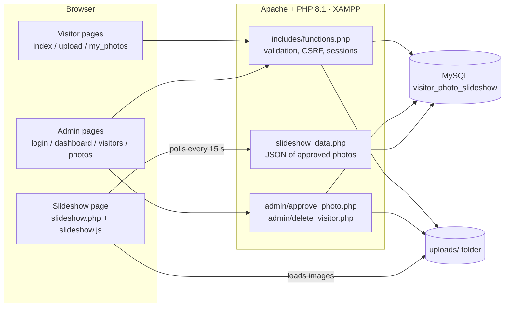
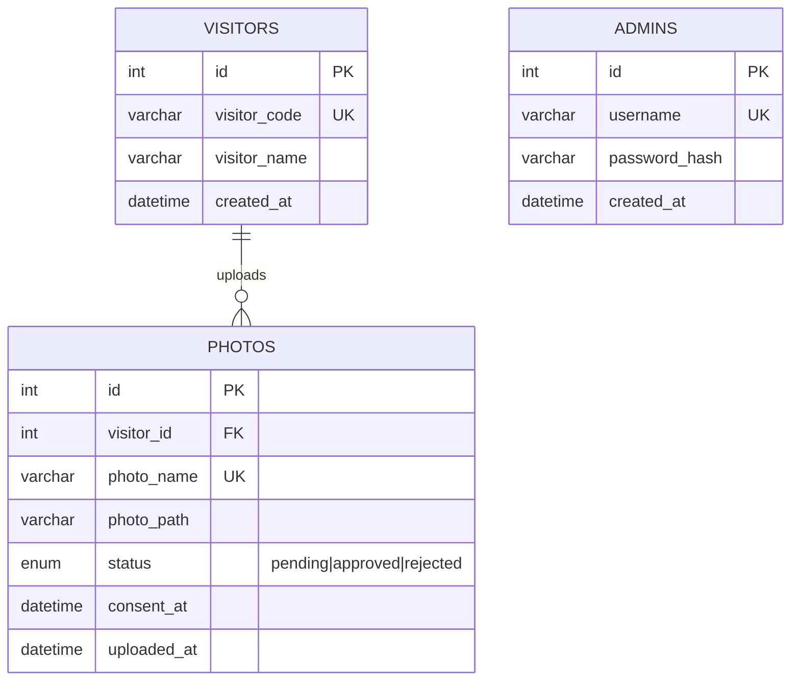
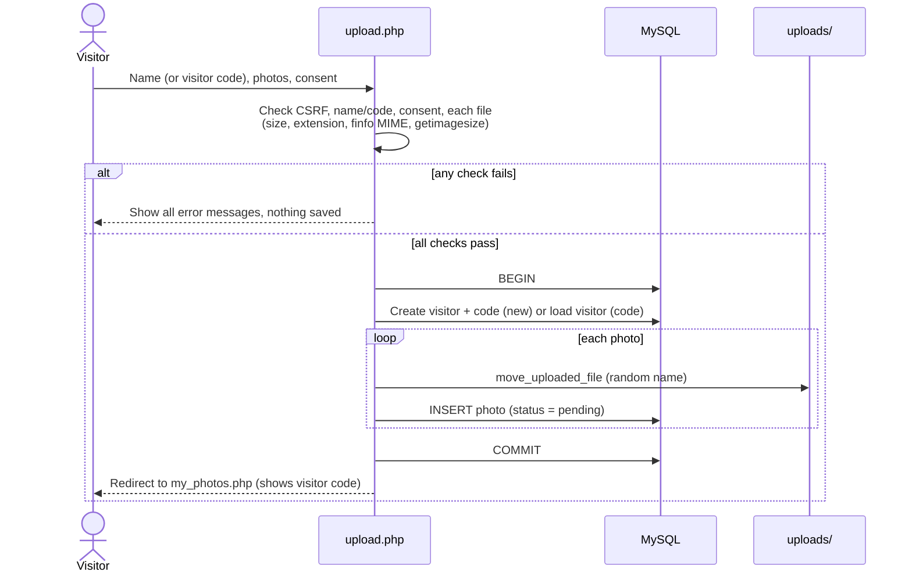
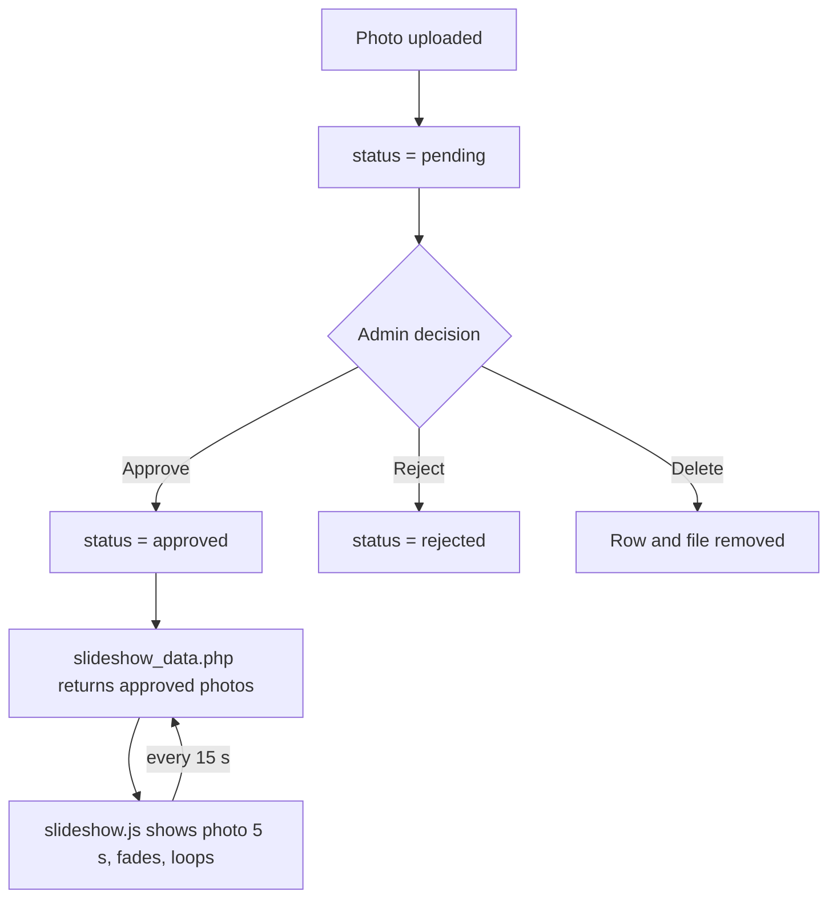
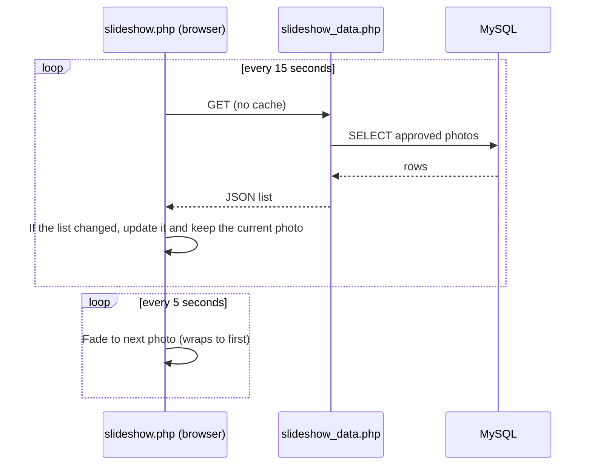

# Architecture

## 1. Technology selection

| Choice | Why |
|--------|-----|
| **Core PHP 8.1+** | Required by the assignment; runs directly on XAMPP; no framework to learn or install. |
| **MySQL + PDO** | Relational data (visitors -> photos) with foreign keys; PDO prepared statements stop SQL injection. |
| **Bootstrap 5 + custom CSS** | Fast responsive layout; `style.css` adds the project's own design system. |
| **Plain JavaScript (ES5)** | No build step; runs on older smart-TV browsers. |
| **Session + bcrypt (`password_hash`)** | Standard, safe PHP admin authentication. |
| **File storage in `uploads/`, path in DB** | Simple and fast; database stays small. |

## 2. System architecture

## 3. Database design

Tables: `visitors`, `photos`, `admins`. Foreign key `photos.visitor_id -> visitors.id` with `ON DELETE CASCADE`.
Indexes: unique `visitors.visitor_code`, unique `photos.photo_name`, `(status, uploaded_at)` for the slideshow query, `photos.visitor_id`, unique `admins.username`.
`photos.consent_at` (an addition to the required columns) records when consent was given.

## 4. Visitor upload workflow

## 5. Approval and slideshow workflow

## 6. Security layers
CSRF tokens on all POST forms - PDO prepared statements - output escaping with `e()` - bcrypt password hashes - session ID regenerated at login - login lock-out after 5 failures - extension + MIME + image checks - random file names - `uploads/.htaccess` disables script execution - `config/`, `includes/`, `sql/`, `tests/` blocked from browsers - admin pages call `require_admin()` - redirects restricted to a whitelist.
